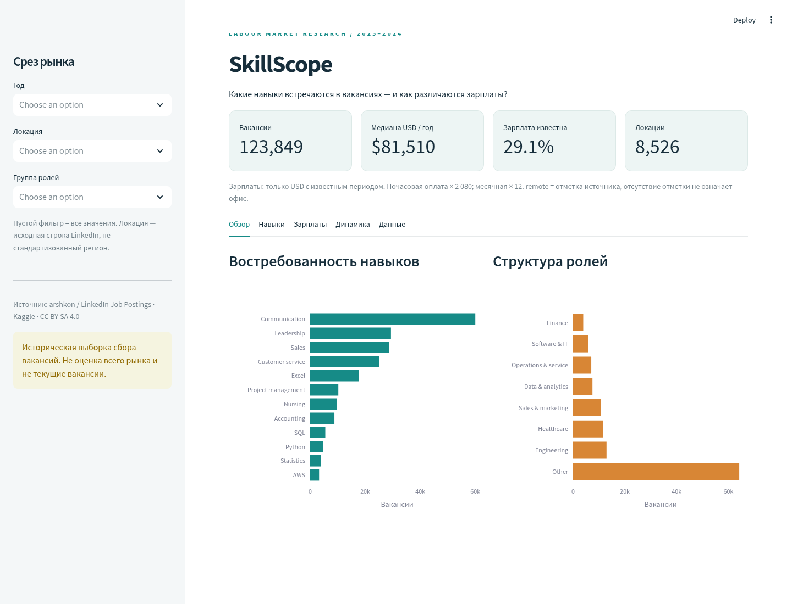

# Job Market Skills Analytics

**Тема №14 · Cluster 2 · Programming for Data Analysis and Database**

Анализ навыков, зарплат и групп профессий на реальном наборе **LinkedIn Job Postings (2023–2024)**. Проект включает чанковую обработку 517 МБ CSV, SQLite, 10 аналитических SQL-запросов, EDA, временные ряды, сравнение трёх прогнозов и интерактивный Streamlit-дашборд.



## Готовые материалы

- [Письменный отчёт PDF](reports/report.pdf) · [Markdown](reports/report.md)
- [Презентация PPTX — 12 слайдов](reports/presentation.pptx)
- [Результаты полного запуска](reports/summary.json) · [Аудит данных](reports/audit.json)
- [Метрики прогноза](reports/forecast_metrics.csv) · [SQL-результаты](reports/sql)
- [Интерактивный график](reports/figures/07_interactive_skills.html) — скачать и открыть локально; GitHub не исполняет HTML
- [ER-диаграмма](docs/schema.md) · [Соответствие требованиям](docs/requirements.md)
- [Данные и лицензия](data/README.md) · [Подготовка к защите](docs/defense.md)

## Быстрый старт

Python **3.11 или 3.12**, команды из корня репозитория. Никаких API-ключей для демо.

```bash
python -m venv .venv
source .venv/bin/activate
# Windows PowerShell: .venv\Scripts\Activate.ps1
pip install -r requirements.txt
python -m jobmarket demo
```

Запуск дашборда на демо (1 000 реальных записей):

```bash
# Linux / macOS
JOBMARKET_DATA_DIR=data/demo streamlit run app.py
```

```powershell
# Windows PowerShell
$env:JOBMARKET_DATA_DIR="data/demo"
streamlit run app.py
```

Открыть http://localhost:8501. Фильтры: год, локация, группа ролей. Пустой фильтр означает «все». Вкладки: обзор, навыки, зарплаты, динамика, данные/CSV.

Демо хранится в `data/demo/` и **не перезаписывает результаты полного исследования** в `reports/`. Это первые 1 000 строк источника, а не репрезентативная выборка. Для восстановления окружения полного запуска на Python 3.12 используйте `pip install -r requirements-lock.txt`.

## Полное воспроизведение исследования

Нужно около 2 ГБ свободного места; обработка текстов может занять несколько минут. Загрузка ~166 МБ ZIP, исходный CSV ~517 МБ. Авторизация Kaggle не требуется при доступности публичного API.

```bash
python -m jobmarket download
python -m jobmarket ingest --input data/raw/linkedin/postings.csv --chunksize 10000
python -m jobmarket analyze
python scripts/build_documents.py
streamlit run app.py
```

Перед запуском на полном наборе сбросьте переменную `JOBMARKET_DATA_DIR`, если устанавливали её для демо (`unset JOBMARKET_DATA_DIR` / `Remove-Item Env:JOBMARKET_DATA_DIR`).

Загрузчик закреплён на **версии 13**. Если Kaggle временно ограничивает скачивание, скачайте `postings.csv` из [источника](https://www.kaggle.com/datasets/arshkon/linkedin-job-postings) и поместите в `data/raw/linkedin/`. Для совпадения с опубликованными результатами проверьте SHA-256 в `reports/audit.json`. Большие файлы не загружаются в GitHub; задание допускает ссылку на источник.

Дополнительные команды:

```bash
python -m jobmarket menu
python -m jobmarket ingest --input path/to/postings.csv --output data/custom
python -m jobmarket analyze --data data/custom --output data/custom/reports
python -m pytest -q
```

`ingest` заменяет базу/витрину в указанном output после успешного построения. `analyze` перезаписывает результаты в output. Сторонний CSV должен иметь `job_id,title,description,location`; опциональные поля соответствуют исходному датасету LinkedIn.

## Методы и корректность

- **Навыки:** словарь из 30 английских навыков, алиасы, границы токенов; каждый навык учитывается один раз на вакансию. Java не извлекается из JavaScript. Это анализ упоминаний, не подтверждённых требований.
- **Роли:** упорядоченные правила по заголовкам; категория Other для остальных. Локации сохраняются как исходные строки, без геокодирования.
- **Зарплаты:** только USD и известный период оплаты. `med_salary` → середина min/max → единственная известная граница. Почасовая × 2 080, дневная × 260, недельная × 52, двухнедельная × 26, месячная × 12. Пропуски не заполняются. Неположительные/обратные диапазоны отклоняются. IQR-выбросы сохраняются.
- **Даты:** UTC, `original_listed_time`, иначе `listed_time`. Неизвестные дни сбора не заполняются нулями. Анализ динамики использует самый длинный непрерывный отрезок с наблюдениями; это не гарантия полноты сбора внутри него.
- **Прогноз:** naive baseline, trailing mean 7 дней, linear trend 14 дней. Последние 7 дней — последовательный one-step holdout, каждый прогноз использует только прошлое. MAE, время и пик Python-аллокаций. Для запуска нужны минимум 21 день подряд; при недостатке данных этап явно пропускается. Декомпозиция period=7 требует 14 дней и не участвует в прогнозе.
- **SQL/Pandas:** совпадение полной таблицы частот навыков проверяется программно. CSV/Parquet сравниваются на одинаковой очищенной витрине, три последовательных чтения. Кэш ОС не сбрасывается. `tracemalloc` не равен RSS и не учитывает все нативные буферы.

Данные исторические и неслучайно собранные; выводы нельзя переносить на весь рынок или 2026 год. Нет ручной разметки для оценки точности NLP. Краткий holdout показывает результат одного эксперимента, а не устойчивый выбор лучшей модели.

## Структура

```text
jobmarket/        загрузка, очистка, навыки, аналитика, SQL-фильтры, CLI
app.py            интерактивный Streamlit-дашборд
sql/              нормализованная схема и 10 запросов
tests/            тесты расчётов, целостности, прогнозов, фильтров
scripts/          воспроизводимая генерация отчёта и презентации
data/sample/      1 000 реальных исходных записей
reports/          результаты полного исследования и материалы сдачи
docs/             ER-диаграмма, требования, объяснения для защиты
```

## Сдача и авторство

Автор: **Kylyshbekov Daniyar**. Учебную группу нужно вписать перед сдачей. При командной работе добавьте реальных участников и их вклад. Проект подготовлен с помощью AI-ассистента: проверьте правила раскрытия такого использования в вашем университете и самостоятельно разберите код перед защитой.

Выбор темы должен быть утверждён преподавателем. Отчёт и презентацию нужно загрузить в Moodle за 2–3 дня до экзамена; репозиторий сам по себе этого не делает.

Код — MIT. Исходные/производные данные — **CC BY-SA 4.0**, автор arshkon и участники набора; [атрибуция](data/README.md).
