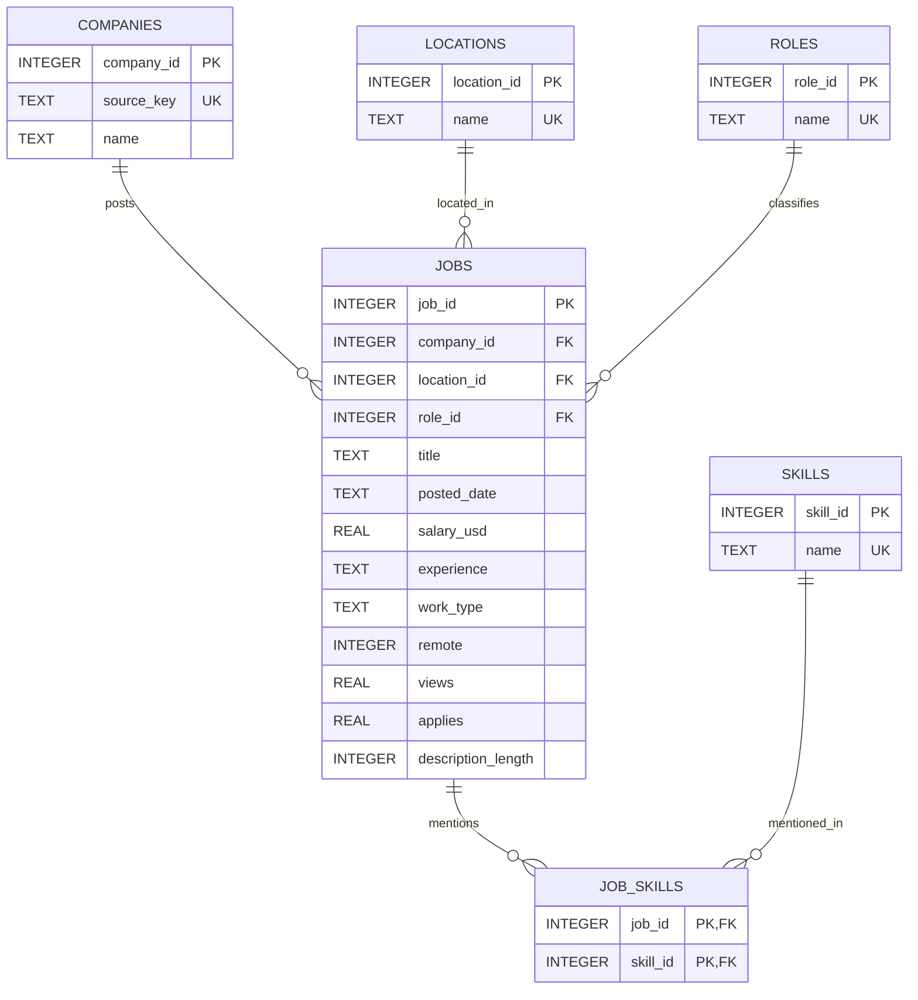

# ER-диаграмма и нормализация

Справочники компаний, локаций, ролей и навыков вынесены из фактов вакансий.
Каждый неключевой атрибут зависит от ключа своей таблицы. Составной ключ
`job_skills(job_id, skill_id)` исключает повторный учёт навыка в вакансии.
`source_key` компании: исходный company_id, иначе точное имя; разные исходные
ID могут иметь одинаковые имена. Неизвестные компании объединены в Unknown.
Роль — результат классификации заголовка правилами, а не метка работодателя.
Текст локации не геокодируется. Исходные описания остаются в CSV; база
содержит извлечённые навыки и длину текста. В Parquet хранится денормализованная
аналитическая витрина для быстрых расчётов Pandas.

При загрузке включён `PRAGMA foreign_keys=ON`, после загрузки выполняется
`PRAGMA foreign_key_check`. Построение идёт во временные файлы; итоговая база
заменяется только после успешной обработки CSV.
